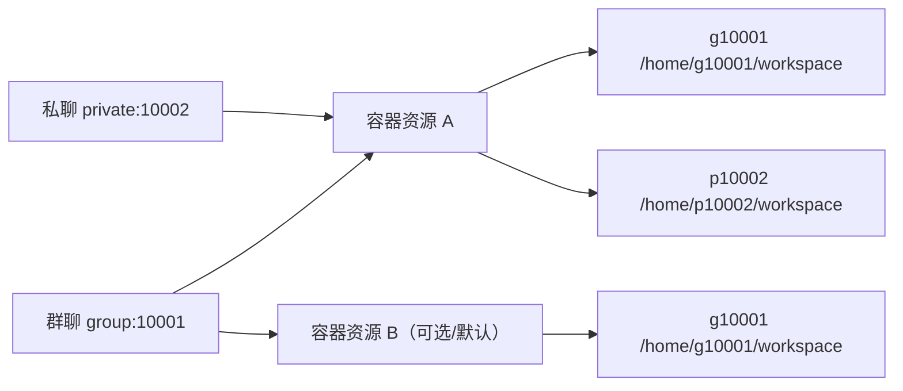
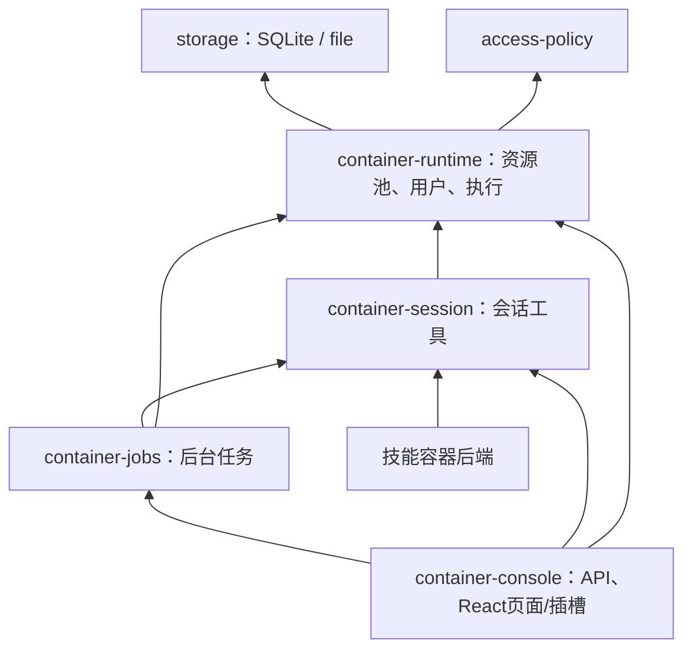

# 容器资源池与会话用户（2026-10-28）

容器是独立资源，不再以 QQ 会话号作为容器身份。容器可使用 `QQ-agent-script-runtime` 等名称，注册时保存引擎返回的不可变 ID。会话仍用 `group:群号` / `private:QQ号` 标识，分别映射为 `g群号` / `pQQ号` Linux 用户。



一个会话可绑定多个容器，其中一个为默认项。同一个容器可绑定多个会话。同名会话用户在不同容器中拥有各自的文件和 UID；不会因此共享文件。

## 操作入口

1. **设置 → 容器 → 资源池**：填写可选容器名称，创建独立资源；不再要求填写会话标识。
2. **登记已有容器**：发现当前引擎中的所有容器，包括 `QQ-agent-script-runtime`；选中后登记。登记仅保存引用，不修改标签、配置、用户或文件。
3. **管理绑定**：按会话名称选择多个会话，保存；或在 **会话 → 设置 → 容器** 多选已有资源并指定默认项。会话页没有创建入口。
4. **执行与任务**：选择会话身份和可选容器执行，查看任务输出和取消结果。

首次执行才准备账号。群聊 10001 使用 `g10001`；私聊 10002 使用 `p10002`。目录 `/home/<用户>`、`workspace`、`.tmp` 权限均为 0700；任务 `umask=077`。用户不加入其他附加组，HOME/TMPDIR 指向自身目录。

全局创建的资源标为“托管”，可在无绑定、无任务时删除。登记的外部资源标为“外部登记”，取消登记保留真实容器。两者均可明确启用／停用；停用会取消该资源全部会话任务并停止容器。停用后的资源不能由 Agent 自动启动。

解绑保留账号和文件，再次绑定同一会话时可继续使用。其他会话绑定到该资源后，只获得自己的新目录；不会继承原会话的私有工作区。

## 执行与权限边界

宿主 CLI 始终使用 `shell:false` 与 argv。账号和任务参数经 JSON stdin 传入固定 Python 程序，模型命令不会拼进宿主命令。账号按实例 owner 标记登记；重名但没有本实例登记记录的账号会拒绝使用，不接管已有用户。

账号管理及任务监控使用容器内 root 控制进程，实际任务先清空附加组，再切换 GID、UID，开启 no_new_privs、0700 私有目录、077 umask。实际 UID 非 root、有效 capabilities 为 0。新建容器 drop ALL，只为控制进程添加 CHOWN、DAC_OVERRIDE、FOWNER、SETUID、SETGID、KILL；没有 privileged、宿主挂载或 socket 参数。

监控进程使用 Linux subreaper 接管脱离进程组的后代。取消／超时通过任务 UUID、PID 和启动时间核对，仅清理该任务进程树；包括 double-fork / setsid 后代。任务另有容器内截止计时，不只依靠宿主 CLI。失败无法确认清理时，资源会停用以阻止后续任务，不直接杀整个共享容器。

共享资源使用 Linux 文件与用户权限隔离，仍共享容器内核、网络和公共系统目录；管理员／容器内 root 可访问文件，用户主动公开权限的文件也可共享。需要不同网络、资源配额或更强隔离时，选择不同容器。

镜像必须有 python3、useradd、groupadd，以及所用语言和文件工具；不自动下载安装。当前正式镜像为 `localhost/qq-harness-skills:26.10`。外部容器保留原始权限和资源配置，缺少用户管理能力时会报错，不降级为 root 执行模型代码。早期本工程以 cap-drop ALL 创建的容器可能不能创建用户；需在资源池创建符合新权限要求的容器，并由管理员迁移文件，程序不偷偷提升旧容器权限。

## 生命周期与调度

- 同一会话在同一容器上的任务串行；不同会话、不同资源可以并行。
- 入队时固定容器 ID，改变默认项不改变已排队任务的目标。
- `container_stop` 和后台任务取消只影响当前会话任务，不停止共享容器。
- 插件卸载／应用正常停止会取消自有任务，保留容器运行和文件。重启后加载池及绑定，历史 running 后台任务标为 interrupted，不自动重发执行。
- 直接强杀宿主后，容器内监控仍按任务截止时间清理；引擎失联时须在恢复后检查任务状态。
- 后台任务上限16个，每会话2个，约100条有界历史；当前会话停止同时取消排队任务。

Linux 机制参考：[subreaper](https://www.man7.org/linux/man-pages/man2/PR_SET_CHILD_SUBREAPER.2const.html)、[no_new_privs](https://www.man7.org/linux/man-pages/man2/PR_SET_NO_NEW_PRIVS.2const.html)、[capabilities](https://man7.org/linux/man-pages/man7/capabilities.7.html)。

## 插件依赖与存储



`plugin_state(namespace='container-runtime', key='pool-v2')` 单条原子保存 `{version:2, resources, bindings}`。文件后端保存对应的 plugin-state JSON。账号 UID/GID 在首次创建后回写绑定。settings、owner、旧 bindings/unbound 保留；不会启动旧单体宿主。全部依赖见 [生成清单](plugin-dependencies.md)。

容器内 owner 记录在 `/var/lib/qq-harness-users/`，任务监控记录在 `/run/qq-harness-<owner>/`，均仅 root 可写。任务完成后删除任务记录。宿主不复制容器文件到生产聊天数据目录。

## API / 工具

| API | 行为 |
| --- | --- |
| GET /api/containers/status | 配置、引擎、资源与全部绑定 |
| GET /api/containers/discovery | 发现引擎容器，标注是否登记 |
| POST /api/containers/inventory | `{name?,image?}` 创建独立资源；旧 chatKey 请求兼容保留 |
| POST /api/containers/inventory/import | `{reference}` 登记已有名称或 ID |
| PUT /api/containers/bindings/:chatKey | `{containerIds,primaryContainerId?}` 保存会话全部绑定 |
| PUT /api/containers/inventory/:id/chats | `{chatKeys}` 保存资源全部会话绑定 |
| POST /api/containers/inventory/:id/start, stop | 管理员启用／停用整个资源 |
| DELETE /api/containers/inventory/:id | 无绑定无任务时删除托管资源或取消外部登记 |
| POST /api/containers/sessions/:chatKey/exec | 指定可选 containerId，支持后台任务 |
| POST /api/containers/sessions/:chatKey/stop | 取消该会话任务，保留共享容器 |

旧 POST bindings 增加一条关系，DELETE bindings/:chatKey 可加 containerId 只解绑一个。其他会话任务查询与取消接口保持兼容。

`container_list` 仅返回当前会话绑定及默认项；`container_status/start/stop/bash/read/write/glob/grep` 支持可选 `containerId`，只能选择本会话已绑定项，省略使用默认项（stop 省略时取消此会话全部资源任务）。文件路径相对私有 workspace；旧 `/tmp/qq-harness-workspace` 前缀映射到私有目录。没有任意目标 chatKey 参数。后台任务查询／取消依然受 chatKey 约束。技能后端默认选择会话默认资源，无绑定时仅 JS 降级 Worker，Python/Shell 不落到宿主执行。

## 迁移、上线与回滚

默认构造只在内存转换旧绑定；显式离线升级工具可先预览、备份并幂等落盘，不执行任何容器命令。

```powershell
node --import tsx tools/upgrade-container-pool.ts --data-dir=D:\QQAgent\qq-harness\var\production
node manage.mjs stop
node --import tsx tools/snapshot-release.ts --offline
node --import tsx tools/upgrade-container-pool.ts --data-dir=D:\QQAgent\qq-harness\var\production --apply --offline
# 提升经过验收的候选版本，再启动
node manage.mjs start --all
node manage.mjs save
```

旧绑定的共享工作区只复制给原绑定会话的私有目录，原目录保留；其他新绑定会话不会复制。旧未绑定资源只登记到池，不自动把其旧工作区交给新会话。目录迁移在首次实际使用时进行。

回滚前停止应用，按工具返回的 backup 目录执行 `--restore=<绝对备份目录> --apply --offline`，再还原上线前 launch.json 版本指针并启动。仅恢复 pool-v2 键，不覆盖其他数据库数据；如果上线后绑定发生变化，工具拒绝覆盖，先导出当前池并人工决定映射。旧版本无法表达多对多关系。取消登记外部容器不删除其用户文件，回滚也不删除这些文件。

## 验收证据

自动化使用 mock Docker／Podman、临时SQLite／文件数据；覆盖资源发现登记、多对多、主容器、显式选择、排队目标固定、g/p身份、跨会话文件与任务隔离、取消、停用、卸载、旧标签、幂等迁移和回滚。浏览器覆盖池和会话选择、外部发现、批量绑定、React停用确认及窄屏布局。

人工实测为 Podman，本机技能镜像，独立测试数据及所有权标签；实际验证 UID 非root、CapEff=0、NoNewPrivs=1、目录0700、中文文件权限拒绝、按容器选取、跨UID发信号拒绝、double-fork/setsid取消、并行任务不受影响、超时、卸载及重启恢复。JS／Python／Shell技能在容器执行，取消后容器仍运行；全部测试容器清理，QQ消息数0。Docker仅mock验证。

入口：`tools/accept-container-pool.ts --real`、`tools/accept-skill-container.ts --real`、`tools/verify-containers.ts --engine=podman --image=localhost/qq-harness-skills:26.10`。最终批次及正式版本记录见 [上线记录](container-pool-20261028.md)。
