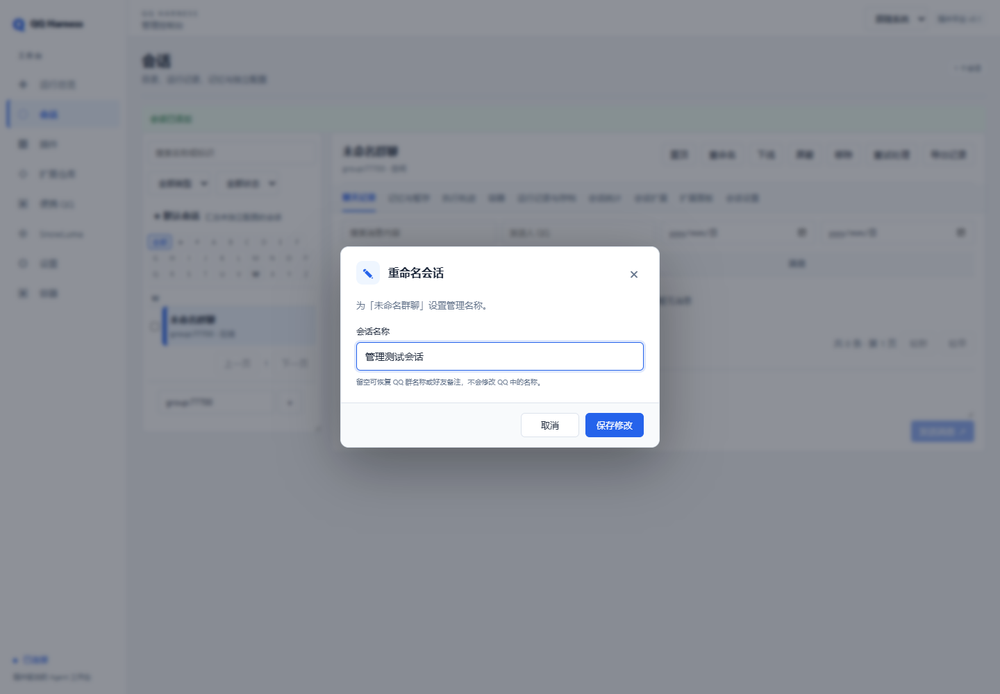
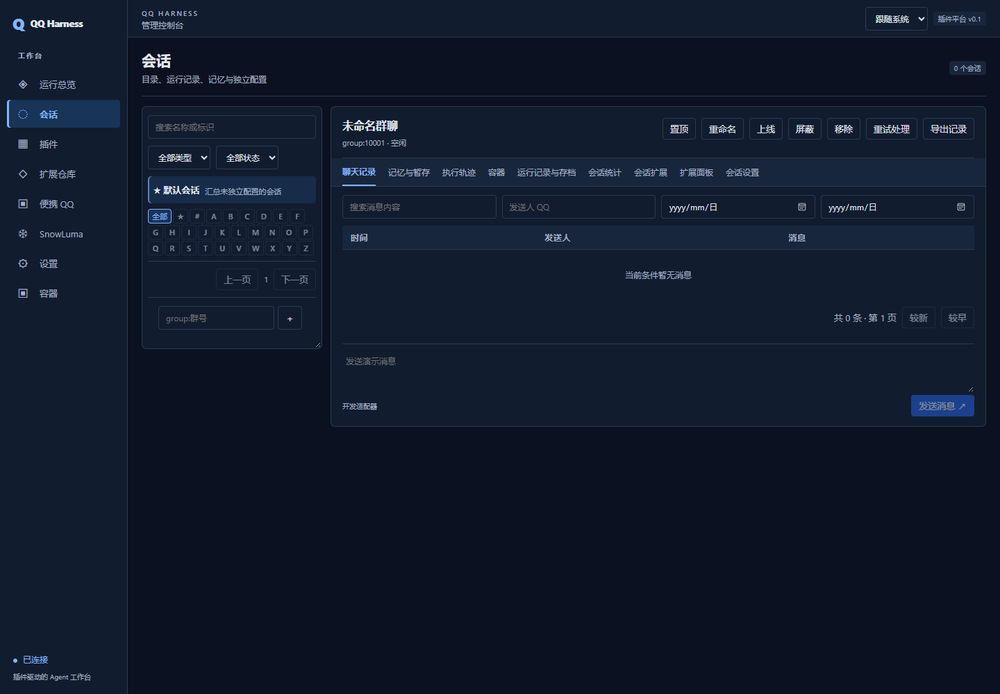

# 管理、记忆与上线验收（2026-10-27）

范围只含 qq-harness；backup/source 为只读参考与数据来源。下述自动化不读生产聊天、不启动真实 QQ／SnowLuma、不调用收费模型。生产恢复属于用户已授权的人工部署操作，没有主动发送真实聊天消息或测试付费模型。

## 验证结果

| 项目              | 结果与证据                                                                                          |
| ----------------- | --------------------------------------------------------------------------------------------------- |
| TypeScript strict | `npm run typecheck` 通过                                                                            |
| Vitest            | 22个测试文件、119项通过；`var/verification/implementation-tests-final.log`                          |
| React浏览器流程   | 12项通过；`var/verification/implementation-e2e-final.log`                                           |
| 构建              | 后端、控制台、迁移工具通过；`var/verification/implementation-build-final.log`                       |
| 架构              | 内核无业务依赖，前端无Node/服务端依赖，运行代码无旧检出引用                                         |
| 插件依赖          | 40个官方/示例插件清单与源码一致，含可选调用和客户端依赖                                             |
| Podman真实容器    | Ubuntu26.10全部通过，测试容器已删除，QQ发送0；`var/verification/containers-management-20261027.log` |
| 升级幂等          | 正式库重复预览：changed=false、待转换0、待导入0                                                     |
| 回滚              | SQLite和文件仓储都验证恢复原层级、原配置和启动边界；备份校验、活进程锁拒绝均覆盖                    |

记忆测试覆盖草稿延迟生效、短中长传播、旧事实抑制、无消息笔记、笔记修订／删除、到期但未整理保护、到期归档、重启补偿、失败游标与重试、取消迟到模型、并发修订冲突及会话隐私。会话测试覆盖快照、记忆继承、分区恢复、目录凭据保护、模型备用、概率及时段、准入边界、分页、统计和逐目标人工发送（mock）。

浏览器覆盖主题初始应用、三种模式、系统实时变化、刷新持久化、元数据和设置、未保存编辑、记忆草稿整理、插件装卸、QQ/SnowLuma启动表单（mock）。重命名用例明确禁止原生弹窗，并验证失败保留输入、Esc和返回焦点。

Podman实测覆盖创建、启动、命令、中文文件读写、后台任务、取消和超时停止容器、重启后文件保留、插件卸载、重新启用恢复绑定、宿主重启恢复绑定、删除及所有权标签。Docker仅mock验证。

## 正式迁移与运行快照

- 迁移前预览：37个旧来源文件，83条有效记忆，未识别／排除归档均为0；7条现有中长期记录需要转换。
- 离线应用：旧记录转换7条、旧项目导入83条，当前有效记录为短期90、中期0、长期0。90条均等待后续整理；保留期已重算，不因旧时间立即消失。之后正常运行会逐层整理，数量随时间变化。
- 人设5项、提示词1项、渠道1项、独立会话配置7个保留。7个会话均有管理名称，QQ名称缓存取得6个，另一个使用已迁移别名；号码为辅助信息。
- 生产launch.json不再包含allowedChats；启动时清空PM2遗留环境，准入统一由会话目录与独立配置决定。管理令牌关闭，模型与OneBot凭据保留且API脱敏。
- 当前镜像已由缺失的24.04改为本机已有的 `docker.io/library/ubuntu:26.10`，引擎及镜像可用。
- 3310 HTTP就绪，PM2 online且已保存；35个当前装配插件无失败，QQ与内部托管SnowLuma运行，OneBot已连接。

本次数据备份：

`var/production/backups/management-v3-2026-10-26T19-06-04-817Z-387b41e9`

目录名使用UTC，实际本地日期为2026-10-27。运行核对的脱敏计数保存于 `var/verification/production-management-20261027.json`。来源文件哈希记录在本地迁移档案，不在公开文档写记忆正文或凭据。

## 本轮发现并修复的问题

1. 浏览器原生prompt/confirm、弹窗失败后焦点丢失、抽屉未隔离背景：统一React组件并增加浏览器回归。
2. 首屏主题内联脚本被CSP阻止：改为同源阻塞脚本，在React与CSS前应用主题。
3. 记忆仅按时间清理会丢失未整理内容：增加成功整理标记，满足时间和整理次数两个条件才自动归档。
4. 旧记忆不在短期、来源成员没有聊天历史无法查看：幂等短期迁移，保留来源及成员索引。
5. 容器部分更新会由schema默认值覆盖未提交字段：只应用实际提交键；镜像探测改用CLI成功状态，兼容Podman。
6. Windows回收旧PID后，新conhost被误认为旧Harness持锁：核对进程创建时间，识别复用PID，隔离旧锁且不结束无关进程。

## 界面预览与后续操作

操作说明见 [管理控制台](management-console.md)、[记忆系统](memory-system.md)、[上线步骤](go-live.md) 与 [回滚命令](management-upgrade.md)。系统总图与每个插件依赖见 [system-map.md](system-map.md) 和 [plugin-dependencies.md](plugin-dependencies.md)。

边界：新复制QQ副本和Electron本机运行问题仍保持原记录；当前沿用旧版可用QQ安装。主动话题、完整媒体预处理和扩展市场不在本轮。旧版本二进制制品需另行匹配归档，数据回滚验证不能代替它。真实账号回复效果由操作者选择会话验收。
