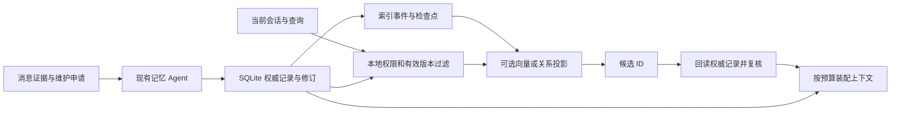

# qq-harness 开源记忆方案接入调研

2026 年 10 月 28 日。面向当前 qq-harness 的多人群聊、跨会话共享、分层文档和主动上下文注入。

适合优先验证的是 **Mem0 TypeScript 的向量组件作为可重建检索投影**。qq-harness 继续保存权威记忆、修订、来源、遗忘账本和维护任务。LivingMemory 与 MaiBot 值得借鉴群聊身份、共享范围和自动召回；Graphiti 适合后续关系图需求；Letta Code 和 Memobase 更适合作为其他整体架构的参考。

接入外部记忆引擎不会自动完成“有效短期直接注入、中长期主题摘要注入”。这部分仍需要 qq-harness 自己装配上下文，并负责摘要来源和失效。

## 接入结论

下表中的适配判断针对当前工程，能力描述基于所列源码快照。

| 方案             | 当前可用形态                                                    | 适合接入的位置                                              | 判断                             |
| ---------------- | --------------------------------------------------------------- | ----------------------------------------------------------- | -------------------------------- |
| Mem0 TypeScript  | Apache-2.0；npm 的 `mem0ai/oss`；完整 Memory API 和公开向量组件 | 优先放在 `MemoryIndex` 后；模型嵌入另接 `EmbeddingProvider` | 可进入候选验证，已有最小原型     |
| LivingMemory     | AGPL-3.0；AstrBot Python 插件                                   | 借鉴作用域、自动召回、注入预算、参与者元数据                | 群聊功能贴近，直接嵌入成本较高   |
| MaiBot A_Memorix | GPL-3.0；MaiBot Python 子系统与 SDK Tool 接口                   | 借鉴共享会话组、人物身份解析和画像证据版本                  | 多人设计有价值，当前宿主依赖较重 |
| Graphiti         | Apache-2.0；Python 图谱库，另有参考 MCP／REST 服务              | 可选关系图投影服务                                          | 有明确关系图需求后再评估         |
| Letta Code       | Apache-2.0；TypeScript Agent 运行时、MemFS 和 App Server        | 全新 Agent 运行模式或上下文组织参考                         | 作为单独记忆插件的适配收益较低   |
| Memobase         | Apache-2.0；Python HTTP 服务、Postgres／pgvector 和 Redis       | 单人画像服务，或画像与事件预算装配参考                      | 多人群聊不是其主要数据组织方式   |

许可证名称取自各快照的 LICENSE 文件。当前仓库 AGENTS.md 明确“社区扩展不作为框架源码复制或再分发”，因此第三方验证代码与 SDK 依赖只放在忽略目录，接入方案优先考虑公开接口或独立实现设计。

## qq-harness 已有的接入边界

当前系统已经具备跨会话记忆的基本数据结构：

- `chat`：会话事实。
- `chat_person`：某个人在当前会话里的事实。
- `person`：获准跨会话使用的个人事实。
- `chat_only/cross_chat`、敏感标记、来源、事实版本、正文修订、到期时间和派生关系共同决定可用内容。

权威仓储 `MemoryRepository` 的事务是同步回调，SQLite 与文件仓储支持事务内的状态、正文和任务提交。外部 HTTP 记忆服务无法直接加入这个本地事务。若替换整个仓储，就需要重新设计跨服务一致性、修订冲突和失败回滚。

检索接口已经独立：`MemoryIndex` 接受 upsert、remove、search、rebuild，查询时接收当前会话、成员集合和 **allowedIds**，只返回记录 ID 和相关性；`EmbeddingProvider` 也已预留。默认装配允许替换 `memoryIndex` 插件。源码见 [领域接口](../packages/domain/src/index.ts)、[装配入口](../apps/server/src/app.ts) 和 [查询实现](../plugins/agent-memory/src/service.ts)。

因此，适配风险较低的路径是保留本地事实，再用索引事件和检查点更新外部投影。删除或旧版本即使暂时留在投影里，也必须在本地校验后退出结果。索引失效时继续使用原有词面回退。

## Mem0 TypeScript

### 已核实能力

当前仓库的 TypeScript SDK 为 3.3.1，公开 `mem0ai/oss` ESM 入口；支持 Node >=18，许可证为 Apache-2.0。npm 3.3.1 包已在隔离目录完成导入和 SQLite 验证。[package.json](https://github.com/mem0ai/mem0/blob/26cdefb46600c0fa5953c4b5ee5003c125539fc4/mem0-ts/package.json)

完整 Memory API 支持用户、Agent、会话作用域、元数据过滤、增删改查和历史。`infer:false` 可以直接保存宿主已经整理好的正文，跳过再次提炼。完整 API 自行生成记忆 UUID，因此需要宿主 ID 映射。[写入实现](https://github.com/mem0ai/mem0/blob/26cdefb46600c0fa5953c4b5ee5003c125539fc4/mem0-ts/src/oss/src/memory/index.ts#L840)

还可直接使用公开导出的 `MemoryVectorStore`、`Qdrant` 等组件。向量组件的 insert 接受调用方提供的 ID，适合直接使用 qq-harness 的记录或片段 ID。这里可避开完整 Memory API 的再次生成 ID、额外历史和提炼流程。[向量组件](https://github.com/mem0ai/mem0/blob/26cdefb46600c0fa5953c4b5ee5003c125539fc4/mem0-ts/src/oss/src/vector_stores/memory.ts#L223)

### 两种接法

**优先候选：只用向量组件。** 新插件实现现有 `MemoryIndex`，存储宿主 ID、revision 和可见范围；嵌入由独立提供器生成。qq-harness 继续维护内容。这样与现有数据职责最接近。

**备选：完整 Memory API 作为投影。** 使用 `infer:false`，保存 `record_id/revision` 元数据，再维护本地 ID 到 Mem0 UUID 的映射。这保留更多 Mem0 功能，但要处理更多同步状态。再次启用它的自动提炼，会形成两个维护者，需要额外规定事实归属和更正流程。

### 需要补齐的部分

- 完整 API 的重复直接导入会生成多个 UUID，不能把索引事件重放当成幂等写入。
- update 接口没有 qq-harness 的 `expectedRevision` 事务语义；实验确认旧 revision 元数据可以覆盖新 revision，适配层须先拦截。
- 只按某人的 user_id 查询，会把该人的私聊和共享记录一起取出。允许范围由 qq-harness 计算，并在检索截断前传入。
- Mem0 内置到期日期不能取代宿主的毫秒级期限和“到期但尚未整理”的保留语义。
- 不能假定托管版能力都在开源版中。当前 v3 资料明确：开源版没有可查询的 Graph Memory、托管 Dream 整理、Memory Decay 和 Temporal Reasoning；仍有实体提取与排序增益。[版本能力对照](https://github.com/mem0ai/mem0/blob/26cdefb46600c0fa5953c4b5ee5003c125539fc4/docs/platform/platform-vs-oss.mdx)

### 中文与运行成本

当前 TypeScript 默认 SQLite 向量组件会遍历保存的向量，计算余弦相似度再排序。它适合小规模验证；数据大时应评估 Qdrant 等后端。[搜索实现](https://github.com/mem0ai/mem0/blob/26cdefb46600c0fa5953c4b5ee5003c125539fc4/mem0-ts/src/oss/src/vector_stores/memory.ts#L352)

其 SQLite BM25 按空白切词，词形处理主要面向英文。实验中“讨论”没有命中未分词中文句子里的对应子串。中文混合检索应保留 qq-harness 的字符片段词面路径，或专门增加中文分词；不能用“换成 Mem0”代替中文检索评测。[切词](https://github.com/mem0ai/mem0/blob/26cdefb46600c0fa5953c4b5ee5003c125539fc4/mem0-ts/src/oss/src/vector_stores/memory.ts#L247)、[词形处理](https://github.com/mem0ai/mem0/blob/26cdefb46600c0fa5953c4b5ee5003c125539fc4/mem0-ts/src/oss/src/utils/lemmatization.ts#L242)

默认 SQLite 组件引入 `better-sqlite3`，与宿主现有 `node:sqlite` 是不同依赖。研究环境的 Windows 安装与运行通过；后续发布仍需锁定 Node、原生模块和嵌入模型版本。默认遥测可通过 `MEM0_TELEMETRY=false` 关闭。[遥测开关](https://github.com/mem0ai/mem0/blob/26cdefb46600c0fa5953c4b5ee5003c125539fc4/mem0-ts/src/oss/src/utils/telemetry.ts#L13)

如果唯一需求是向量检索，直接使用嵌入提供器和 Qdrant 客户端也是需要比较的轻量基线。Mem0 更适合需要复用多个存储适配器和其检索组件的情况。

## LivingMemory

当前快照为 2.8.1，核心是 Python，并依赖 AstrBot 的消息事件、模型 Provider、人设管理器、日志与临时上下文部件。[元数据](https://github.com/lxfight-s-Astrbot-Plugins/astrbot_plugin_livingmemory/blob/da8c25f8d53c4f94659362fc0cc93162d1bddb11/metadata.yaml)、[维护入口](https://github.com/lxfight-s-Astrbot-Plugins/astrbot_plugin_livingmemory/blob/da8c25f8d53c4f94659362fc0cc93162d1bddb11/core/managers/memory_engine.py)、[召回入口](https://github.com/lxfight-s-Astrbot-Plugins/astrbot_plugin_livingmemory/blob/da8c25f8d53c4f94659362fc0cc93162d1bddb11/core/event_handler_modules/memory_recall.py)

### 多人和跨会话设计

其作用域解析很明确：

- session：同一个群或私聊的独立范围。
- user：同平台、同一个用户跨会话使用一个范围。
- global：广泛共享一个范围。
- isolated_sessions：指定会话优先保持独立。
- 另有白名单与身份别名，覆盖写入和读取入口。

[作用域源码](https://github.com/lxfight-s-Astrbot-Plugins/astrbot_plugin_livingmemory/blob/da8c25f8d53c4f94659362fc0cc93162d1bddb11/core/memory_scope.py#L128) 是一个纯函数模块，已使用合成事件验证八项行为。

需要注意，user 模式会让同一人的群聊和私聊得到同一个命名空间。这个模式表达了共享选择，但不能直接替代 qq-harness 逐条记录的来源、敏感性和可见范围规则。它也不是同时返回“当前群公共事实 + 群内成员事实 + 获准共享个人事实”的完整联合查询策略。

它有参与者身份元数据及面向当前发言者的搜索，支持把“这个人参与过哪些经历”作为检索入口。这比仅靠问题文本搜相似句子更贴合群聊。[参与者检索](https://github.com/lxfight-s-Astrbot-Plugins/astrbot_plugin_livingmemory/blob/da8c25f8d53c4f94659362fc0cc93162d1bddb11/core/managers/memory_engine_participant.py#L211)

### 接入判断

最值得借鉴的是先过滤范围再截断、自动召回和主动工具并用、近期内容保留位置、注入预算、来源证据读取，以及临时注入不写回聊天历史。

直接加载需要 AstrBot；拆出 MemoryEngine 则要适配模型、事件、人设、FAISS／文档存储和生命周期。源码里依赖明确存在，当前快照没有把这些能力提供成可直接 import 的 TypeScript 记忆库。对 qq-harness，借鉴或独立服务化的收益需要超过宿主剥离成本，才值得采用。

## MaiBot A_Memorix

当前 MaiBot 快照为 1.3.17，要求 Python >=3.12。其 A_Memorix 子系统文档将架构定位为 SDK Tool 接口，统一入口为 host service 和 SDKMemoryKernel；旧独立 server.py 已移除。[版本依赖](https://github.com/Mai-with-u/MaiBot/blob/6bcb2e068cd98793a132cb8cc4ebf3cc00cb8fc3/pyproject.toml)、[子系统文档](https://github.com/Mai-with-u/MaiBot/blob/6bcb2e068cd98793a132cb8cc4ebf3cc00cb8fc3/src/A_memorix/README.md#L19)

### 最值得借鉴的能力

它支持明确的共享记忆会话组：当前会话命中某组后，检索该组解析出的会话集合；另有全局共享选项。相比只有“本会话／全部共享”，这种配置更适合相关项目群之间的有限共享。[共享组解析](https://github.com/Mai-with-u/MaiBot/blob/6bcb2e068cd98793a132cb8cc4ebf3cc00cb8fc3/src/common/utils/utils_config.py#L623)、[查询路由](https://github.com/Mai-with-u/MaiBot/blob/6bcb2e068cd98793a132cb8cc4ebf3cc00cb8fc3/src/A_memorix/host_service.py#L259)

人物画像服务以 person_id 为基础，精确处理姓名和别名；同名或子串匹配不能直接认领身份。画像输入保存证据指纹，并考虑分类实现和模型配置等会影响输出的因素。这些设计适合用于我们计划增加的摘要与画像失效机制。[人物画像服务](https://github.com/Mai-with-u/MaiBot/blob/6bcb2e068cd98793a132cb8cc4ebf3cc00cb8fc3/src/A_memorix/core/utils/person_profile_service.py#L107)

### 接入判断

当前 kernel 直接导入 MaiBot 的 chat_manager、日志、LLMServiceClient；人物服务还依赖 PersonInfo、数据库会话和全局配置。SDK Tool 入口并不表示它已经是与宿主无关的 SDK。[kernel 依赖](https://github.com/Mai-with-u/MaiBot/blob/6bcb2e068cd98793a132cb8cc4ebf3cc00cb8fc3/src/A_memorix/core/runtime/sdk_memory_kernel.py#L11)、[人物服务依赖](https://github.com/Mai-with-u/MaiBot/blob/6bcb2e068cd98793a132cb8cc4ebf3cc00cb8fc3/src/A_memorix/core/utils/person_profile_service.py#L18)

直接接入会增加 Python、FAISS／数值计算、MaiBot 宿主桥接和一套记忆管理状态。对于只升级记忆的当前工程，适配成本较高。建议优先独立实现其“共享会话组”和“画像证据指纹”设计，保留我们的修订、事务和管理入口。共享组配置还需服从现有逐条来源限制，不能因为两个群加入同组就自动放开其中的私有事实。

## Graphiti

当前 graphiti-core 快照为 0.31.2，要求 Python >=3.10，许可证为 Apache-2.0。支持 Neo4j、FalkorDB 等图数据库，并可配置 LLM、嵌入和重排器。[依赖](https://github.com/getzep/graphiti/blob/efc40d21b0afe28d6fc31d8c2c3e05752b02a9f1/pyproject.toml)、[构造与服务依赖](https://github.com/getzep/graphiti/blob/efc40d21b0afe28d6fc31d8c2c3e05752b02a9f1/graphiti_core/graphiti.py#L209)

它适合表示人、项目、事件之间的关系，并保存事实有效时间与来源。查询过滤器支持有效／失效时间、边类型、边 ID、起点终点实体以及属性条件。[过滤接口](https://github.com/getzep/graphiti/blob/efc40d21b0afe28d6fc31d8c2c3e05752b02a9f1/graphiti_core/search/search_filters.py#L55)

接入时可让群聊、私聊和批准共享的数据分别进入由后端确定的图范围。group_id 是数据组织参数，权限仍由 qq-harness 判定；不能把模型自由传入的 group_id 当成准入证明。

参考 MCP 服务的 README 明确说明它是无认证、无授权的参考实现。因此，即使 qq-harness 已有 MCP 插件，也需要受控网关绑定范围，并筛选可调用操作。[参考服务边界](https://github.com/getzep/graphiti/blob/efc40d21b0afe28d6fc31d8c2c3e05752b02a9f1/mcp_server/README.md#L10)

作为当前 MemoryIndex 的直接替代也不理想：图谱会产生新实体、新关系和聚合事实，需要把候选重新关联到权威来源；混合不同可见范围的材料后再从生成摘要里删掉私有来源，并不能可靠恢复隔离。适合先从获准共享、关系明确的合成事件做独立实验。

## Letta Code

当前快照为 0.34.26，TypeScript，Apache-2.0。主产品形态是 Agent 运行时、渠道网关和 App Server；包公开的入口主要包括 App Server 客户端、渠道、调度与部分记忆约束组件。[包入口](https://github.com/letta-ai/letta-code/blob/5dea67021b99810707ff753db35e4534f70ff1fd/package.json#L55)

MemFS 以 Agent 为根组织记忆，并结合 Git、核心记忆和外部文件；渠道路由把聊天及线程映射到 agentId 与 conversationId。[记忆目录](https://github.com/letta-ai/letta-code/blob/5dea67021b99810707ff753db35e4534f70ff1fd/src/agent/memory-filesystem.ts#L46)、[渠道路由](https://github.com/letta-ai/letta-code/blob/5dea67021b99810707ff753db35e4534f70ff1fd/src/channels/routing.ts#L43)

这种结构适合“同一个 Agent 在多个会话持续积累经验”。用于多人 QQ 时，仍需明确 Agent 共享经验与每个人的访问范围如何对应。若把现有会话直接绑定同一个 Agent，不能据此获得我们的逐记录来源限制。

为了只增加一个记忆模块而再运行一套工具循环、模型路由、记忆文件与运行状态，收益较低。若未来要整体新增一种 Agent 运行模式，Letta Code 才是更合理的评估对象。旧 Letta V1 服务器和已归档 lettabot 的教程不应作为本次接入合同。[当前源码入口说明](https://github.com/letta-ai/letta)

## Memobase

Memobase 以 project_id 和 user_id 组织画像、事件和输入。它最值得借鉴的是 context()：按预算组合稳定画像、最近事件和与当前聊天有关的历史内容。[上下文控制器](https://github.com/memodb-io/memobase/blob/358c16bbc6d687937d79bc2f984a11c3be8da901/src/server/api/memobase_server/controllers/context.py#L115)、[数据结构](https://github.com/memodb-io/memobase/blob/358c16bbc6d687937d79bc2f984a11c3be8da901/src/server/api/memobase_server/models/database.py#L242)

不过，一个群有多个事实主体，把整个群塞进一个用户对象会混淆画像；拆成多个用户对象又需要应用层组合、过滤来源和限制总预算。其默认服务栈包含 Postgres／pgvector、Redis 和 Python API。[部署配置](https://github.com/memodb-io/memobase/blob/358c16bbc6d687937d79bc2f984a11c3be8da901/src/server/docker-compose.yml)

该仓库本次快照的主分支最后提交为 2026 年 1 月 11 日，其他五个候选的快照提交均在本次调研前两日内。这个差异应计入维护成本判断，不能由此推断项目已停止服务。

对当前多人群聊工程，context() 的装配思路比引入整套用户画像服务更有直接价值。文档也指出预算约束针对画像和事件内容，最终模板包装仍可能增加长度。[上下文说明](https://github.com/memodb-io/memobase/blob/358c16bbc6d687937d79bc2f984a11c3be8da901/docs/site/features/context.mdx#L80)

## 推荐的接入架构



第一阶段实现可直接改善当前体验的上下文装配：有效短期事实在预算内完整带入；中长期按主题提供有来源的摘要；剩余细节继续用现有工具读取。摘要来源变化、删除或失去访问权限时，相关摘要停止注入并重建。装配每次替换固定记忆块，避免工具循环重复追加。

第二阶段增加可选语义索引。建议候选为 `memory-index-semantic` 插件，接口继续是现有 MemoryIndex；保留中文词面路径。先比较 Mem0 向量组件与直接向量数据库客户端，选依赖和行为更符合本项目的一种。

第三阶段才考虑 Graphiti 的关系图。前两阶段不要求迁移权威正文，也不要求改变对话模型的四个记忆工具。

### 适配器需要完成的工程工作

1. **范围绑定。** allowedIds 必须来自本地权限和有效版本计算。后端配置索引目标，模型不选择其他会话的数据范围。
2. **幂等与修订。** 使用宿主 ID，或从宿主 ID 和片段位置生成稳定的后端 ID，持久化处理进度及必要的删除版本信息；旧写入不能盖过新版本。Qdrant 等后端要求合法 UUID 或数字 ID，分块时不能直接拼接任意字符串。
3. **可重建。** 清空投影后可以从权威记录重建；索引失败继续回退。正式重建应采用新代索引完成后切换，避免长期部分可用。
4. **长文档。** 按主题和段落分块，保存记录 ID、revision 与片段位置；按嵌入模型实际限制控制输入。合并候选时按权威文档去重。
5. **模型管理。** 嵌入模型和维度需要指纹、用量、超时与取消处理；更换模型后重建。第三方引擎自行调用提炼模型时，还需要接入现有 Runs、账单和取消链。
6. **生命周期。** 插件停用时停止后台任务和关闭连接；本地仓储事务不等待外部服务完成。
7. **上下文预算。** 同时计算人设、工具、聊天历史、记忆与输出预留；不能只按条数控制。
8. **来源约束。** 群成员本人陈述、转述、引用和模型推断分别标识；同昵称不自动合并身份，私聊来源按现有共享规则处理。

## 最小验证结果

本次针对接入合同验证，嵌入使用固定模拟向量，未调用外部模型，也未读取真实聊天或生产记忆。结果证明 API 和投影接法可行，不代表中文语义质量、真实模型人物归属或线上吞吐已经通过。

| 验证                          | 结果          | 具体范围                                                                                                                             |
| ----------------------------- | ------------- | ------------------------------------------------------------------------------------------------------------------------------------ |
| Mem0 3.3.1 完整 API           | 13 项检查通过 | SQLite、会话和用户过滤、allowedIds 元数据预过滤、ID／revision 回读、重复导入、旧 revision 写入、更新删除、到期、历史及重新打开数据库 |
| Mem0 向量组件适配原型         | 8 项检查通过  | 宿主 ID 直接用作索引 ID、重复 upsert 幂等、先过滤再 top-k、适配层旧修订和旧删除拦截、删除退出、重建、中文 BM25 子串缺口              |
| LivingMemory 原版作用域纯函数 | 8 项检查通过  | 群隔离、同群多人归域、同人跨群、同人私聊群聊归域、不同人隔离、global、强制隔离及白名单                                               |
| qq-harness 现有记忆回归       | 32 项通过     | 三个现有测试文件；记忆 Agent、分层整理及仓储行为                                                                                     |

“重复导入产生两条”“旧 revision 可写入”“user_id 单独查询包含私聊记录”是被确认的 API 行为，检查通过表示观察与断言一致。这些行为需要适配层约束，不能计为系统已自动解决幂等、版本或共享权限。

重现入口在忽略目录：

```powershell
cd D:\QQAgent\qq-harness\var\research\memory-integration-20261028\mem0-probe
node probe.mjs
node index-probe.mjs

cd D:\QQAgent\qq-harness\var\research\memory-integration-20261028\livingmemory-scope
python probe.py
```

原始结果及来源清单见 [evidence.json](../var/research/memory-integration-20261028/evidence.json)、[Mem0 API 结果](../var/research/memory-integration-20261028/mem0-probe/result.json)、[索引原型结果](../var/research/memory-integration-20261028/mem0-probe/index-result.json)、[作用域结果](../var/research/memory-integration-20261028/livingmemory-scope/result.json)。研究依赖只安装在该目录，没有加入项目 package.json；当前运行插件未改动。

## 后续验证标准

实际接入前，用固定的中文合成数据比较现有词面检索、语义索引和混合检索，至少覆盖：

- 多人同轮说话、相同昵称、引用别人和替别人转述。
- 同一人在两个群中的公共偏好、群内职责和私聊事实。
- 中长期文档更正后的旧片段、遗忘后的摘要与索引。
- 相关词不重合的中文问法、无答案、细节需要回读的历史问题。
- 索引离线、重建、重复事件、迟到旧事件和模型维度切换。

记录 Recall@8、无答案误命中、人物归属正确率、不可见记录进入结果的数量、摘要旧值残留、上下文 token、模型费用和 p95 延迟。不可见事实进入结果应作为阻断问题，不能被平均召回率掩盖。是否采用外部组件，由同一数据集的结果决定。

## 源码快照

| 项目            | 版本或提交             | 主分支提交时间 北京时间   |
| --------------- | ---------------------- | ------------------------- |
| LivingMemory    | 2.8.1 · da8c25f8d53c   | 2026 年 10 月 28 日 11:32 |
| MaiBot          | 1.3.17 · 6bcb2e068cd9  | 2026 年 10 月 28 日 13:42 |
| Mem0 TypeScript | 3.3.1 · 26cdefb46600   | 2026 年 10 月 26 日 22:51 |
| Graphiti        | 0.31.2 · efc40d21b0af  | 2026 年 10 月 28 日 02:02 |
| Letta Code      | 0.34.26 · 5dea67021b99 | 2026 年 10 月 28 日 10:41 |
| Memobase        | 358c16bbc6d6           | 2026 年 1 月 11 日 11:43  |

版本指所读源码内的版本字段；提交时间是分支提交时间，不是对应版本的发布日期。完整 SHA 与 53 个核对文件的固定链接保存在 evidence.json。
