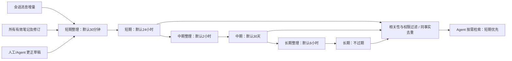

# 三层记忆系统

2026-10-27 起以本文为当前规则。原始聊天记录、笔记、更正草稿和已发布记忆分别保存。

- 三层都有编辑入口。编辑只创建草稿，不立即改写回复上下文；短期整理发布更正后，再按中期、长期周期传播。手动整理可以提前执行一个阶段或全部阶段。
- 聊天增量由模型提炼为事实；笔记与人工更正按明确内容发布，阶段传播保留事实及证据，不额外调用模型改写人工更正。
- `factId` 标识作用域、会话、成员与属性键；`factVersion` 标识事实版本；`derivedFrom` 保存上游记录与修订。新更正发布后，旧中长期版本停止检索，不能在新短期过期后复活。
- 检索先检查会话、成员、可见性、敏感标记及来源准入，再按短期 > 中期 > 长期排序，同事实只返回一个有效版本。索引只是候选投影，权威记录和版本决定结果；索引故障自动回退。
- 会话记忆和会话成员记忆只能用于本会话。自动通用个人记忆仅接受群聊本人明确、非敏感的证据，私聊来源禁止自动共享；笔记默认仅本会话可见。
- 所有有效笔记都参与整理，不要求“重要”或聊天来源。来源使用笔记 ID 与修订号；编辑、删除和过期均保留历史。笔记编辑与主动删除于下一次短期整理反映到事实，之后逐级传播；自然到期仅归档笔记，不撤回已提炼的事实。
- 直接删除记忆立即屏蔽该事实全部层级，并通过短期删除标记向下游传播。自动归档须同时满足到期和至少一次成功整理：短期已进入中期、中期已进入长期；未整理的到期内容仍保留并可检索，避免整理间隔大于保留期时丢失事实。笔记在成功提炼到短期后才允许到期归档。历史修订保留。

整理间隔和短中期保留期由全局默认加会话覆盖组成，独立于会话配置快照。关闭“自动整理”仍允许人工整理；关闭记忆插件或撤销准入会阻止任务和迟到结果提交。会话下线暂停自动整理。

调度进度、下次到期、成功/失败时间、游标及草稿均持久化。相同会话共享 Runs 分区和并发额度，定时与手动整理合并进行；同时到期按短→中→长顺序执行。重启补做一次过期计划，失败不推进消息游标，无新增消息不调用提炼模型。模型请求的取消、用量和运行记录纳入统一管理。

SQLite 升至 user_version=3，增加笔记修订表并回填现存笔记；文件仓储保留相同语义。现有中长期有效事实迁至短期，保留原 ID、原文、来源和旧修订，新增迁移修订并重新计算短期保留期；同一事实的旧派生版本归档。旧文本记忆按最多4000字一段无损导入为短期。backup/source 的旧印象、memory-plus 与长期 SQLite 记忆经离线预览、备份后导入短期，保留文件哈希与来源标识，不伪造聊天证据。迁移可重复执行。

相关接口见 [memory-api.md](memory-api.md)，操作见 [memory-guide.md](memory-guide.md)，升级与回滚见 [management-upgrade.md](management-upgrade.md)。
