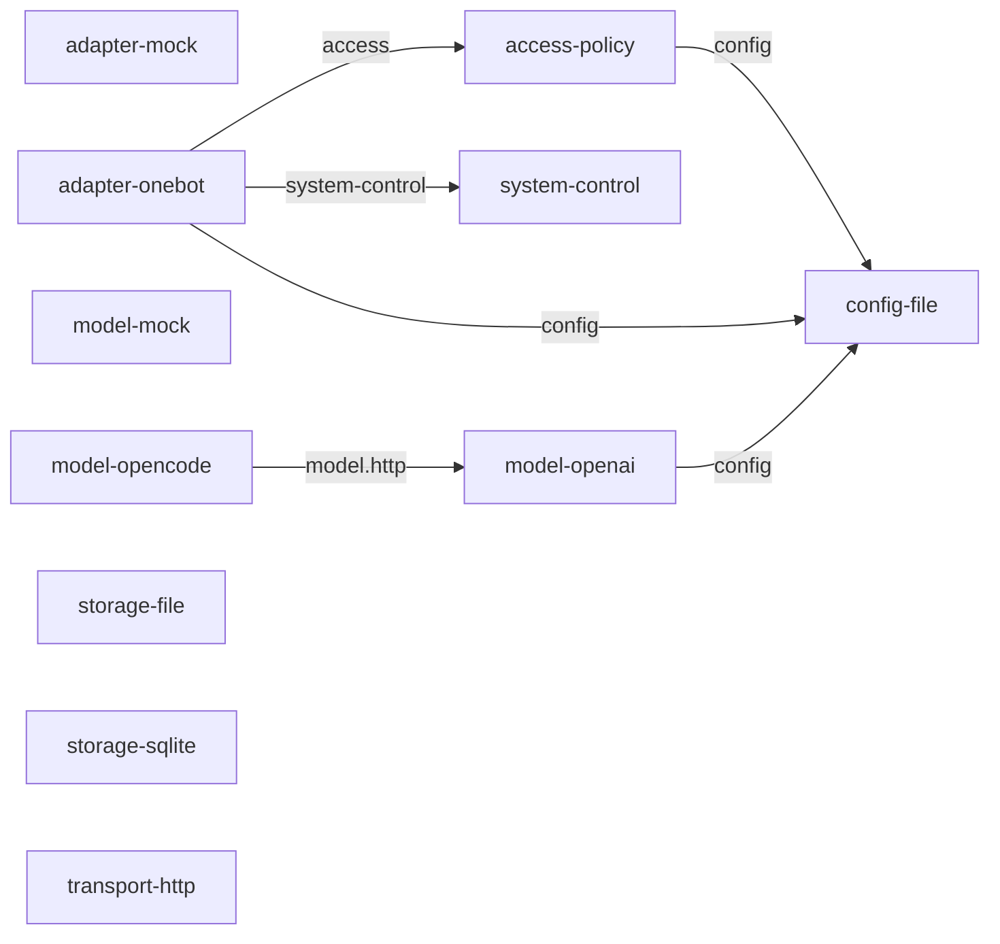
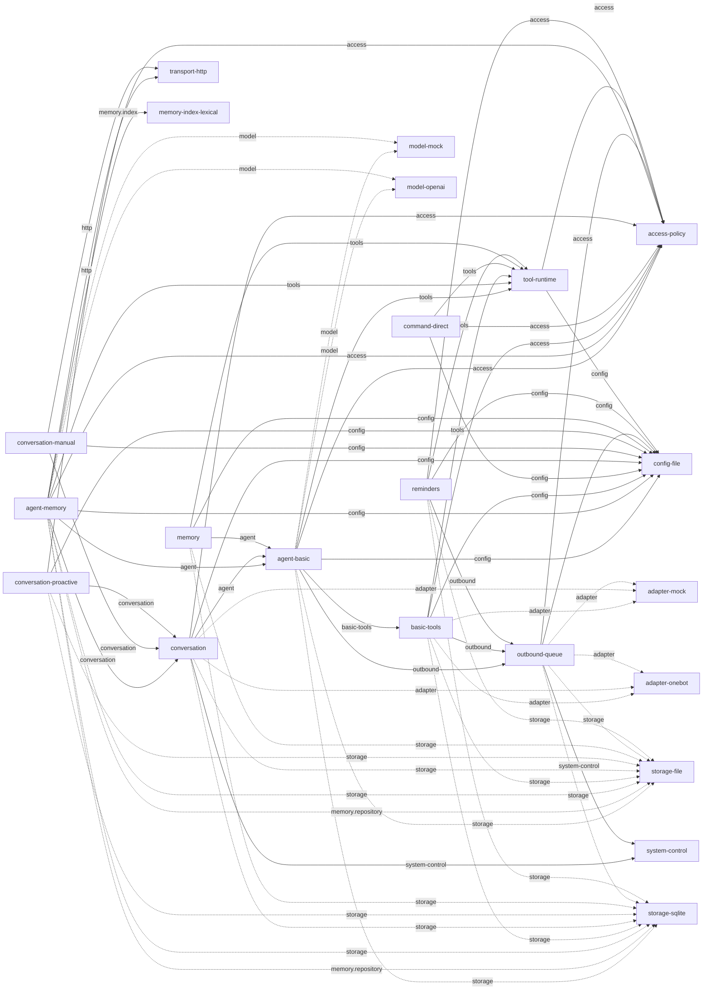
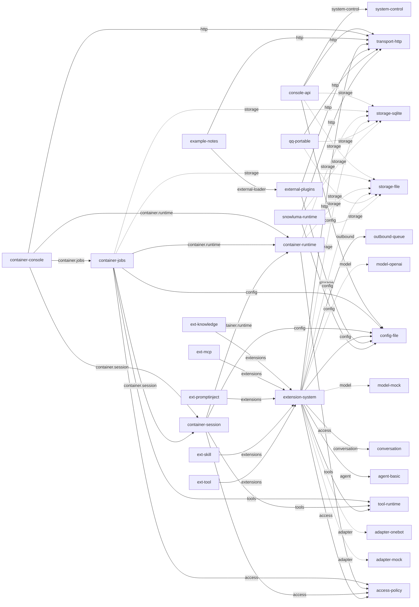
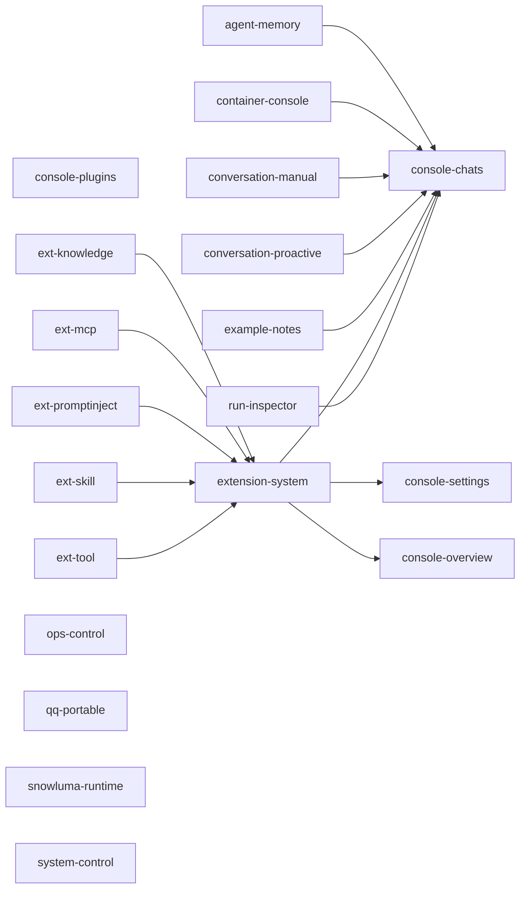

# 插件依赖清单（由源码生成）

覆盖 plugins/ 的 49 个目录及 example-notes 后装示例。运行 `npm run docs:dependencies` 更新，`npm run check:dependencies` 检查漂移。

服务端 requires 填服务名；客户端 requires 填插件 ID。表里的替代提供者按启动配置择一装配，不代表同时启动。动态安装的社区扩展不在此清单内。

| 插件与入口 | 装配方式 | 必需服务 → 提供者 | 对外服务 | 客户端依赖 |
|---|---|---|---|---|
| [access-policy](../plugins/access-policy/src/index.ts) | 默认装配 | `harness.config → config-file` | `harness.access` | — |
| [adapter-mock](../plugins/adapter-mock/src/index.ts) | 演示 | — | `harness.adapter` | — |
| [adapter-onebot](../plugins/adapter-onebot/src/index.ts) | live | `harness.access → access-policy` `harness.config → config-file` `harness.system-control → system-control` | `harness.adapter` | — |
| [agent-basic](../plugins/agent-basic/src/index.ts) | 默认装配 | `harness.access → access-policy` `harness.basic-tools → basic-tools` `harness.config → config-file` `harness.model → model-mock / model-openai` `harness.outbound → outbound-queue` `harness.storage → storage-file / storage-sqlite` `harness.tools → tool-runtime` | `harness.agent` | — |
| [agent-memory](../plugins/agent-memory/src/index.ts) | 默认装配 | `harness.access → access-policy` `harness.agent → agent-basic` `harness.config → config-file` `harness.conversation → conversation` `harness.http → transport-http` `harness.memory.index → memory-index-lexical` `harness.memory.repository → storage-file / storage-sqlite` `harness.model → model-mock / model-openai` `harness.storage → storage-file / storage-sqlite` `harness.tools → tool-runtime` | `@qq-harness/contracts` `harness.memory` `harness.memory.members` | `console-chats` |
| [basic-tools](../plugins/basic-tools/src/index.ts) | 默认装配 | `harness.access → access-policy` `harness.adapter → adapter-mock / adapter-onebot` `harness.config → config-file` `harness.outbound → outbound-queue` `harness.storage → storage-file / storage-sqlite` `harness.tools → tool-runtime` | `harness.basic-tools` | — |
| [command-direct](../plugins/command-direct/src/index.ts) | 默认装配 | `harness.access → access-policy` `harness.config → config-file` `harness.tools → tool-runtime` | — | — |
| [config-file](../plugins/config-file/src/index.ts) | 默认装配 | — | `harness.config` | — |
| [console-api](../plugins/console-api/src/index.ts) | 默认装配 | `harness.config → config-file` `harness.http → transport-http` `harness.storage → storage-file / storage-sqlite` `harness.system-control → system-control` | — | — |
| [console-chats](../plugins/console-chats/client.tsx) | 客户端页面 | — | — | — |
| [console-overview](../plugins/console-overview/client.tsx) | 客户端页面 | — | — | — |
| [console-plugins](../plugins/console-plugins/client.tsx) | 客户端页面 | — | — | — |
| [console-settings](../plugins/console-settings/client.tsx) | 客户端页面 | — | — | — |
| [container-console](../plugins/container-console/src/index.ts) | 默认装配 | `harness.container.jobs → container-jobs` `harness.container.runtime → container-runtime` `harness.container.session → container-session` `harness.http → transport-http` | — | `console-chats` |
| [container-jobs](../plugins/container-jobs/src/index.ts) | 默认装配 | `harness.access → access-policy` `harness.config → config-file` `harness.container.runtime → container-runtime` `harness.container.session → container-session` `harness.storage → storage-file / storage-sqlite` `harness.tools → tool-runtime` | `harness.container.jobs` | — |
| [container-runtime](../plugins/container-runtime/src/index.ts) | 默认装配 | `harness.access → access-policy` `harness.storage → storage-file / storage-sqlite` | `harness.container.runtime` | — |
| [container-session](../plugins/container-session/src/index.ts) | 默认装配 | `harness.access → access-policy` `harness.config → config-file` `harness.container.runtime → container-runtime` `harness.tools → tool-runtime` | `harness.container.session` | — |
| [conversation](../plugins/conversation/src/index.ts) | 默认装配 | `harness.access → access-policy` `harness.adapter → adapter-mock / adapter-onebot` `harness.agent → agent-basic` `harness.config → config-file` `harness.storage → storage-file / storage-sqlite` `harness.system-control → system-control` | `harness.conversation` | — |
| [conversation-manual](../plugins/conversation-manual/src/index.ts) | 默认装配 | `harness.config → config-file` `harness.conversation → conversation` `harness.http → transport-http` | — | `console-chats` |
| [conversation-proactive](../plugins/conversation-proactive/src/index.ts) | 默认装配 | `harness.access → access-policy` `harness.config → config-file` `harness.conversation → conversation` `harness.storage → storage-file / storage-sqlite` | — | `console-chats` |
| [example-notes](../extensions/example-notes/plugin.json) | 后装示例，默认关闭 | `harness.external-loader → external-plugins` `harness.http → transport-http` | — | `console-chats` |
| [ext-knowledge](../plugins/v2-knowledge/src/index.ts) | 默认装配 | `harness.extensions → extension-system` | — | `extension-system` |
| [ext-mcp](../plugins/v2-mcp/src/index.ts) | 默认装配 | `harness.extensions → extension-system` | — | `extension-system` |
| [ext-promptinject](../plugins/v2-promptinject/src/index.ts) | 默认装配 | `harness.extensions → extension-system` | — | `extension-system` |
| [ext-skill](../plugins/v2-skills/src/index.ts) | 默认装配 | `harness.extensions → extension-system` | — | `extension-system` |
| [ext-tool](../plugins/v2-tools/src/index.ts) | 默认装配 | `harness.extensions → extension-system` | — | `extension-system` |
| [extension-system](../plugins/extension-system/src/index.ts) | 默认装配 | `harness.access → access-policy` `harness.adapter → adapter-mock / adapter-onebot` `harness.agent → agent-basic` `harness.config → config-file` `harness.conversation → conversation` `harness.http → transport-http` `harness.model → model-mock / model-openai` `harness.outbound → outbound-queue` `harness.storage → storage-file / storage-sqlite` `harness.tools → tool-runtime` | `harness.extensions` `harness.model.middleware` `harness.network.proxy` `harness.tool-scope` `harness.tools.policy` `harness.video-frames` | `console-chats` `console-settings` `console-overview` |
| [external-plugins](../plugins/external-plugins/src/index.ts) | 配置 extensionDir 时 | `harness.config → config-file` `harness.http → transport-http` | `harness.external-loader` | — |
| [html-renderer](../plugins/html-renderer/src/index.ts) | 默认装配 | — | `harness.html-renderer` | — |
| [image-studio](../plugins/image-studio/src/index.ts) | 默认装配 | `harness.agent → agent-basic` `harness.config → config-file` `harness.media → media-runtime` `harness.outbound → outbound-queue` `harness.storage → storage-file / storage-sqlite` `harness.tools → tool-runtime` | — | — |
| [media-runtime](../plugins/media-runtime/src/index.ts) | 默认装配 | `harness.adapter → adapter-mock / adapter-onebot` `harness.config → config-file` `harness.http → transport-http` `harness.storage → storage-file / storage-sqlite` | `harness.media` | — |
| [media-tools](../plugins/media-tools/src/index.ts) | 默认装配 | `harness.access → access-policy` `harness.adapter → adapter-mock / adapter-onebot` `harness.config → config-file` `harness.media → media-runtime` `harness.outbound → outbound-queue` `harness.storage → storage-file / storage-sqlite` `harness.tools → tool-runtime` | — | — |
| [memory](../plugins/memory/src/index.ts) | 旧简版，默认未装配 | `harness.agent → agent-basic` `harness.config → config-file` `harness.storage → storage-file / storage-sqlite` `harness.tools → tool-runtime` | — | — |
| [memory-index-lexical](../plugins/memory-index-lexical/src/index.ts) | 默认装配 | — | `harness.memory.index` | — |
| [model-mock](../plugins/model-mock/src/index.ts) | 演示 | — | `harness.model` | — |
| [model-openai](../plugins/model-openai/src/index.ts) | live | `harness.config → config-file` | `harness.model` `harness.model.http` | — |
| [model-opencode](../plugins/model-opencode/src/index.ts) | live | `harness.model.http → model-openai` | — | — |
| [ops-control](../plugins/ops-control/src/index.ts) | 默认装配 | `harness.access → access-policy` `harness.adapter → adapter-mock / adapter-onebot` `harness.config → config-file` `harness.http → transport-http` `harness.outbound → outbound-queue` `harness.storage → storage-file / storage-sqlite` `harness.system-control → system-control` | `harness.operations.ingress` | — |
| [outbound-queue](../plugins/outbound-queue/src/index.ts) | 默认装配 | `harness.access → access-policy` `harness.adapter → adapter-mock / adapter-onebot` `harness.config → config-file` `harness.storage → storage-file / storage-sqlite` `harness.system-control → system-control` | `harness.outbound` | — |
| [qq-portable](../plugins/qq-portable/src/index.ts) | 默认装配 | `harness.http → transport-http` `harness.storage → storage-file / storage-sqlite` | `harness.qq-portable` | — |
| [reminders](../plugins/reminders/src/index.ts) | 默认装配 | `harness.access → access-policy` `harness.config → config-file` `harness.outbound → outbound-queue` `harness.storage → storage-file / storage-sqlite` `harness.tools → tool-runtime` | `harness.reminders` | — |
| [run-inspector](../plugins/run-inspector/src/index.ts) | 默认装配 | `harness.config → config-file` `harness.http → transport-http` | `harness.traces` | `console-chats` |
| [snowluma-runtime](../plugins/snowluma-runtime/src/index.ts) | 默认装配 | `harness.config → config-file` `harness.http → transport-http` `harness.storage → storage-file / storage-sqlite` | `harness.snowluma` | — |
| [sticker-tools](../plugins/sticker-tools/src/index.ts) | 默认装配 | `harness.adapter → adapter-mock / adapter-onebot` `harness.agent → agent-basic` `harness.config → config-file` `harness.media → media-runtime` `harness.outbound → outbound-queue` `harness.storage → storage-file / storage-sqlite` `harness.tools → tool-runtime` | `harness.stickers` | — |
| [storage-file](../plugins/storage-file/src/index.ts) | 替代 SQLite | — | `harness.memory.repository` `harness.storage` | — |
| [storage-sqlite](../plugins/storage-sqlite/src/index.ts) | 默认存储 | — | `harness.memory.repository` `harness.storage` | — |
| [system-control](../plugins/system-control/src/index.ts) | 默认装配 | `harness.access → access-policy` `harness.config → config-file` `harness.storage → storage-file / storage-sqlite` | `harness.system-control` | — |
| [tool-runtime](../plugins/tool-runtime/src/index.ts) | 默认装配 | `harness.access → access-policy` `harness.config → config-file` | `harness.tools` | — |
| [transport-http](../plugins/transport-http/src/index.ts) | 默认装配 | — | `harness.http` | — |
| [web-tools](../plugins/web-tools/src/index.ts) | 默认装配 | `harness.config → config-file` `harness.http → transport-http` `harness.storage → storage-file / storage-sqlite` `harness.tools → tool-runtime` | `harness.web` | — |

## 可选服务调用

以下是 src/ 中 use 调用但未列入 requires 的服务。缺席时必须有降级行为，不能把可选依赖误画成启停绑定。兼容宿主内部额外按需使用容器服务。

| 消费者 | 可选服务 → 提供者 |
|---|---|
| agent-basic | `harness.system-control → system-control` `harness.tool-scope → extension-system` `harness.traces → run-inspector` |
| agent-memory | `harness.traces → run-inspector` |
| basic-tools | `harness.media → media-runtime` `harness.traces → run-inspector` |
| console-api | `@qq-harness/contracts → agent-memory` `harness.access → access-policy` `harness.adapter → adapter-mock / adapter-onebot` `harness.conversation → conversation` `harness.memory → agent-memory` `harness.outbound → outbound-queue` `harness.tools → tool-runtime` |
| container-session | `harness.container.jobs → container-jobs` |
| conversation | `harness.operations.ingress → ops-control` |
| extension-system | `harness.container.session → container-session` |
| media-runtime | `harness.network.proxy → extension-system` `harness.video-frames → extension-system` |
| model-openai | `harness.model.middleware → extension-system` `harness.network.proxy → extension-system` `harness.traces → run-inspector` |
| ops-control | `harness.network.proxy → extension-system` |
| outbound-queue | `harness.traces → run-inspector` |
| snowluma-runtime | `harness.adapter → adapter-mock / adapter-onebot` |
| tool-runtime | `harness.tool-scope → extension-system` `harness.tools.policy → extension-system` `harness.traces → run-inspector` |
| web-tools | `harness.network.proxy → extension-system` |

## 接入、配置、存储与模型

箭头从消费者指向提供者；虚线表示同一服务有可替代的提供者。

## 聊天、工具、记忆与提醒

箭头从消费者指向提供者；虚线表示同一服务有可替代的提供者。

## 管理 API、运行时、扩展宿主与管理器

箭头从消费者指向提供者；虚线表示同一服务有可替代的提供者。

## 客户端插件依赖

## 读图说明

- 五个 v2-* 目录的运行 ID 是 ext-tool / ext-mcp / ext-skill / ext-knowledge / ext-promptinject，能力依赖统一指向 harness.extensions。
- SnowLuma 进程托管与 OneBot 适配器相互独立；snowluma-runtime 可选读取适配器连接状态。关闭托管插件不会主动终止外部 QQ/SnowLuma。
- qq-portable 只依赖存储与 HTTP，提供独立登录程序的管理；与 snowluma-runtime、adapter-onebot 无强制启停依赖。登录与协议就绪需分别检查。
- container-session 仅在后台执行请求时调用 harness.container.jobs，避免与 container-jobs 的必需依赖形成环。
- 工具、模式和 hook 归属注册它们的插件；上表的服务依赖负责 Cordis 激活和撤销，表外动态扩展还受各自清单控制。
