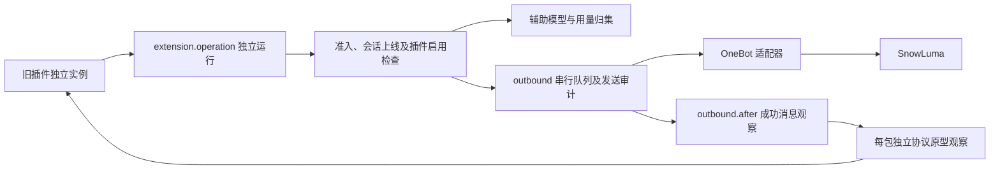

# 协议操作与后台模型边界

本批次代码已通过完整验收并上线；未完成全量业务验收的旧包仍保留在预览目录。最新正式状态以 [status](status.md) 为准。

## 已实现的公共链路

延迟插件任务不能复用已结束的回复运行。辅助模型、输入状态和表情回应按会话建立独立运行，随包停用、取消和准入变化中止；同一操作内的嵌套调用复用绑定，避免单并发时互相等待。辅助模型的输出预算、思考参数、原始用量仍保留，计费和附加用量写入操作档案。

协议原型观察回放的是已经确认的发送结果，观察本身不能二次发送原消息。每个包持有独立Facade，重载不会把不同包补丁叠在同一个原型上。输入状态只允许当前私聊，表情回应必须对应本群已有且可见的消息。

## 发言口径

文字、图片、表情包、文件及拍一拍等聊天交付计入发言。输入状态、消息表情回应和修改头像是协议／账号操作，不伪造聊天消息，也不能单独使 `finish(spoken)` 通过。它们仍有操作轨迹及审计。

头像属于非幂等账号变更，结果未知时不能自动重做；输入状态和指定表情的设置是幂等操作，不因它们的存在误阻断回复失败重试。

## 验证与剩余工作

旧 typing-indicator 验证私聊等待、收尾、停用和不计发言；旧 msg-reaction 验证真实消息成功后的自动观察、概率／每日上限、重载不重复、明确请求和本群目标。模型通道使用SnowLuma HTTP mock验证辅助模型与嵌套协议操作的用量与作用域。

这不是全部旧协议能力完成。发送请求改写、管理员动作、撤回、好友申请及其他旧原型补丁仍须逐项适配和验收。编译与加载清单见 [全部包审计](package-loading-audit-20261027.md)。
