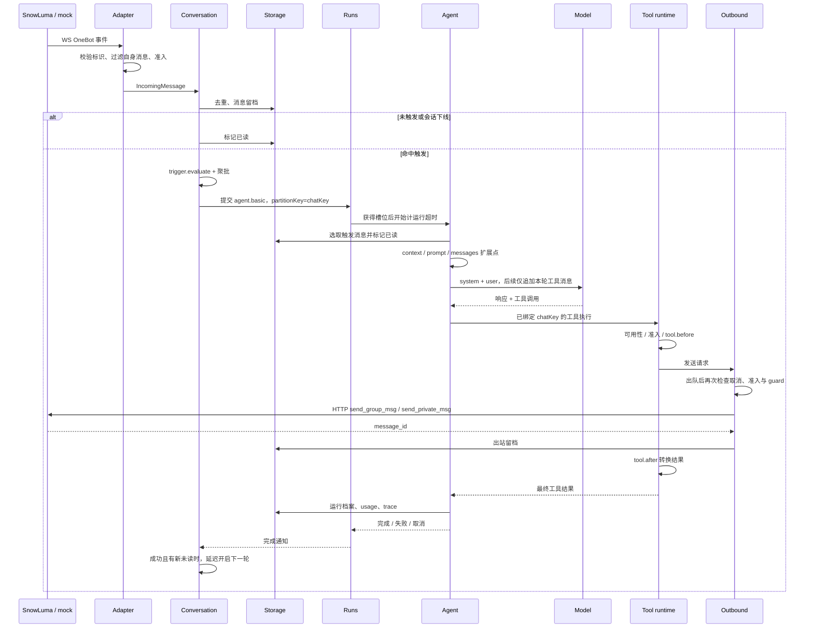
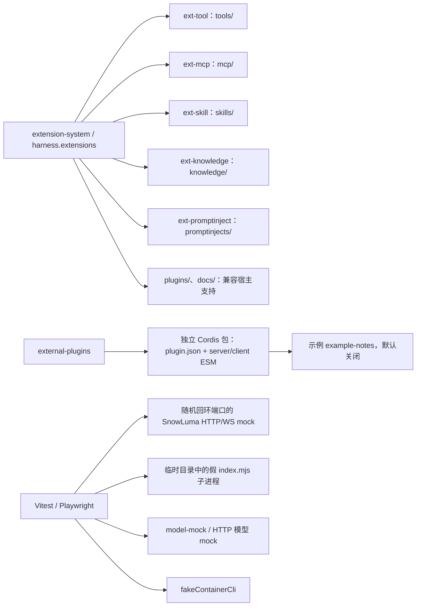
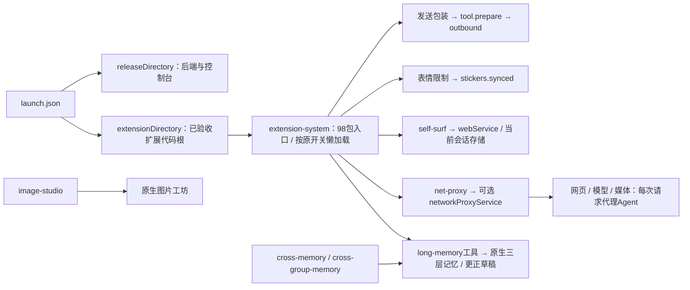

# QQ Harness 系统结构与消息流

范围：`qq-harness` 当前实现；`source` 是历史参考，不参与运行或本轮修改。
所有插件的精确服务依赖、客户端依赖及逐插件入口见 [生成的依赖清单与四组图](plugin-dependencies.md)，机器可读版本见 [JSON](plugin-dependencies.json)。

## 系统总图

实线表示调用或数据流，虚线表示可选管理或扩展关系。

```mermaid
flowchart TB
  QQ["QQ / 外部 SnowLuma"]
  MOCK["测试：SnowLuma HTTP + WS mock"]
  LLM["OpenAI 兼容模型 / model-mock"]
  subgraph host["Host：apps/server / 可选 Electron 桌面壳"]
    ASSEMBLY["createApplication：启动配置、插件装配"]
    subgraph kernel["通用内核：Cordis + plugin-sdk"]
      LIFE["Runtime：服务依赖、激活、撤销"]
      RUNS["Runs：排队、分区互斥、并发、取消、截止时间"]
      POINTS["ExtensionPoints：guard / transform / observe"]
    end
    ADAPTER["adapter-onebot / adapter-mock"]
    ACCESS["access-policy：准入、黑名单、启动边界"]
    CHAT["conversation：入库、去重、触发、聚批、续跑"]
    TOPIC["conversation-proactive：冷场x秒／每y秒概率检查"]
    MANUAL["conversation-manual：手动强制触发"]
    AGENT["agent-basic：system + user、模型与工具循环"]
    MODEL["model-openai / model-mock；model-opencode 请求头增强"]
    TOOLS["tool-runtime：统一 schema、可见性、执行与工具状态"]
    BUILTINS["basic-tools / web-tools / media-tools / sticker-tools / image-studio"]
    MEDIA["media-runtime：消息归属、CQ、QQ刷新、同源图片、视频"]
    RENDER["html-renderer：有界浏览器池、独立页面、受控素材读取、面板PNG"]
    DETAILS["run-inspector：上下文／模型／工具／发送详情，独立gzip，默认30天"]
    OUT["outbound-queue：每会话串行、限频、去重、再次准入、留档"]
    DIRECT["command-direct / reminders：确定性运行模式"]
    MEM["agent-memory：短→中→长期、笔记修订、草稿与调度"]
    INDEX["memory-index-lexical：可重建检索索引"]
    EXT["extension-system：独立兼容宿主 + 五个 ext-* 管理器"]
    CONTAINER["container-runtime / session / jobs / console：资源池与多对多绑定"]
    CONTAINER --> POOL["独立容器资源 A / B / 外部登记"]
    POOL --> USERS["每会话 g群号 / pQQ号：UID、0700目录、任务进程树"]
    SNOW["snowluma-runtime：可选自有子进程托管"]
    QQPORT["qq-portable：独立程序与数据目录、自有进程管理"]
    CONFIG["config-file：全局目录 + 会话完整快照 + 记忆间隔覆盖"]
    CONFIG -.->|"通用并发／队列容量回调"| RUNS
    TOPIC -->|"wake + 插件取消信号"| CHAT
    MANUAL -->|"force + 插件取消信号"| CHAT
    BUILTINS --> TOOLS
    BUILTINS --> MEDIA
    AGENT --> DETAILS
    MODEL --> DETAILS
    TOOLS --> DETAILS
    OUT --> DETAILS
    RUNS --> CHILD["子操作运行：跨会话目标绑定、父级取消、借用执行槽"]
    EXT -.-> INGRESS["公共入站拦截：确定性指令先于模型触发，不加载旧单体"]
    EXT -.-> RENDER
    EXT -.-> SKILL["skill_script_run：声明脚本、参数、运行／卸载取消"]
    SKILL -.-> CONTAINER
    SKILL -.-> WORKER["无容器：仅JS，独立Worker+VM"]
    EXT -.-> VF["video.frames 服务桥：按会话选择已启用的提供者"]
    MEDIA -.-> VF
    INGRESS -.-> CHAT
    STORAGE["storage-sqlite 默认 / storage-file 可替换"]
    HTTP["transport-http：Host / Origin / token / API / SSE"]
    API["console-api + 各插件 API"]
  end
  subgraph browser["浏览器 / Electron 控制台"]
    SHELL["React shell：紧凑后台布局、亮暗主题、React 弹窗、路由与 SSE"]
    CLIENT["ClientHost：页面、插槽、客户端依赖、换代重载"]
    PAGES["总览、会话、提示词管理、内置工具、扩展、QQ、SnowLuma；设置分组含容器"]
  end
  DB[("隔离数据目录：SQLite / JSON / JSONL / gzip")]
  RELEASE["var/builds 验收 → var/releases 固定版本 → launch.json 选择；PM2稳定入口"]
  DOCKER["Docker / Podman CLI；测试使用 fake CLI"]
  ASSEMBLY --> LIFE
  RELEASE --> ASSEMBLY
  LIFE --> RUNS
  LIFE --> POINTS
  QQ <-->|"WS 入站 / HTTP 动作"| ADAPTER
  MOCK <-->|"测试替身"| ADAPTER
  ADAPTER --> ACCESS --> CHAT
  CHAT --> STORAGE
  CHAT --> QINTENT["conversation-queue：任务意图、排队截止、重启恢复未执行任务"]
  QINTENT --> STORAGE
  CHAT --> RUNS --> AGENT
  AGENT --> MODEL <--> LLM
  AGENT --> TOOLS --> OUT --> ADAPTER
  OUT --> ACCESS
  OUT --> STORAGE
  DIRECT --> RUNS
  MEM --> STORAGE
  MEM --> INDEX
  MEM --> MODEL
  MEM -.-> POINTS
  EXT -.-> POINTS
  EXT -.-> TOOLS
  EXT -.-> MODEL
  TOOLS -.-> CONTAINER --> DOCKER
  SNOW -.->|"仅管理自有子进程"| QQ
  QQPORT -.->|"QQ 登录窗口；仅管理自有子进程"| QQ
  CONFIG --> CHAT
  CONFIG --> ACCESS
  CONFIG --> AGENT
  STORAGE --> DB
  CONFIG --> DB
  HTTP --> API
  API --> LIFE
  API --> CONFIG
  API --> STORAGE
  SHELL <-->|"API + SSE"| HTTP
  SHELL --> CLIENT --> PAGES
```

## 分层边界

| 层       | 代码                                                          | 责任与约束                                                            |
| -------- | ------------------------------------------------------------- | --------------------------------------------------------------------- |
| 启动宿主 | `apps/server`、`apps/desktop`                                 | 选择 demo/live、数据目录和插件组合；生产入口持有实例锁                |
| 内核     | `packages/kernel`、`packages/plugin-sdk`                      | 不认识 QQ、模型、HTTP、React；只负责服务生命周期、模式和扩展点        |
| 契约     | `packages/contracts`、`packages/domain`                       | 前者供前后端共享数据类型和校验；后者定义服务端领域服务接口            |
| 业务插件 | `plugins/*/src`                                               | 接入、准入、消息、工具、模型、记忆、容器、HTTP 都通过服务组合         |
| 客户端   | `apps/console`、`packages/client-sdk`、`plugins/*/client.tsx` | shell 不按业务页面 ID 分支；依赖换代时重建消费者                      |
| 兼容层   | `packages/extension-compat`                                   | vendor 原文校验 SHA；环境替换放 bridge/构建层，运行时注册表按实例隔离 |
| 持久化   | `storage-sqlite` / `storage-file`                             | 默认 SQLite；消息、档案、记忆与插件状态以仓储为权威；索引可重建       |

`requires` 不是 npm 包依赖。服务端消费 `harness.*` 服务；客户端消费插件 ID。同一个服务可由不同插件实现，例如 `harness.adapter`、`harness.model`、`harness.storage`。后端缺少依赖时进入 waiting，依赖恢复后由 Cordis 自动重新激活。

## 一次消息的完整路径

失败或取消且未发言时，Agent 恢复触发消息为未读；取消不会主动无限重试。取消可以阻止后续提交，但无法撤回已经被协议端接收的消息。

## 扩展系统与测试边界

两种扩展体系有不同的清单和生命周期入口。`v2-*` 是目录名，运行时管理器 ID 为 `ext-*`。生成的依赖表覆盖本仓库官方插件和示例，不枚举用户随后安装的社区代码。

### 旧包公开适配边界

代理服务可选，卸载后恢复直连；不修改全局 dispatcher。扩展不能直接创建旧宿主实例。上述编译／公开接口适配、包生命周期检查和局部业务测试分别见[本轮补齐](runtime-completion-20261027.md)与[逐包矩阵](parity-matrix.md)。

测试不加载真实 SnowLuma，不读生产配置和聊天记录，不启动或关闭用户 QQ。进程管理测试启动的是测试生成的最小 Node 脚本；协议测试通过真实 HTTP/WS 边界验证 mock，不把适配器实现整体替换掉。

三层记忆内部流和版本优先级见 [记忆系统图](memory-system.md)。管理流程和旧版功能对照见 [控制台说明](management-console.md)。全部官方页面的弹窗、抽屉和未保存确认共用 client-sdk，业务页面仍由插件注册，shell 不识别业务插件 ID。
